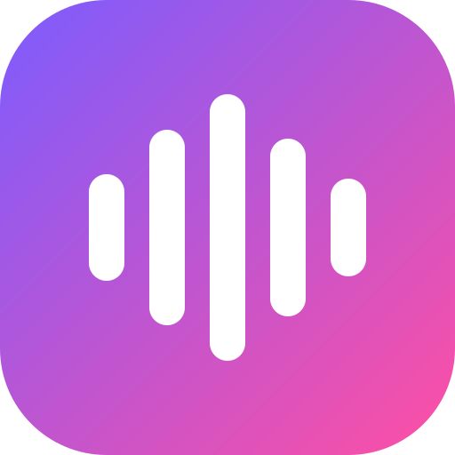

<h1 align="center">Onde</h1>

Un lecteur de musique pour Windows, beau et léger : tes MP3/MP4, YouTube et Spotify au même endroit.

<a href="https://github.com/nayzen-bot/onde/releases/latest/download/Onde-Setup.exe"><b>⬇ Télécharger Onde pour Windows</b></a>

## Installer

1. Télécharge **Onde-Setup.exe** (lien au-dessus).
2. Lance-le. Si Windows affiche « Windows a protégé votre ordinateur », clique sur **Informations complémentaires** puis **Exécuter quand même** (l'app n'est pas signée, c'est normal pour un petit projet).
3. C'est tout : Onde est dans le menu Démarrer. Les mises à jour se font depuis l'app.

Pas besoin de droits administrateur. Tes sons et réglages sont dans `Musique\Onde` et ne sont jamais effacés par une mise à jour ou une désinstallation.

## Ce que ça fait

- Tes fichiers **MP3, MP4, M4A, FLAC, WAV…** (glisser-déposer ou dossier entier)
- Liens **YouTube** (téléchargés en MP3 ou MP4 au choix) et **Spotify** (joués en entier, playlists importées titre par titre)
- Playlists, favoris, file d'attente, aléatoire, répétition, recherche
- Volume général jusqu'à 300 % et **volume par son**
- Pochette sur chaque son, couleurs qui suivent la musique, visualiseur, mode immersif
- **Discord** : « Écoute … » sur ton profil, et la musique dans ton micro (avec VB-Cable)
- La musique continue quand tu fermes la fenêtre (icône près de l'heure)
- **Communauté** : partage tes playlists et écoute celles des autres

## Communauté

Les posts sont de simples liens YouTube / Spotify (jamais de fichiers audio). Pour poster, connecte-toi avec GitHub depuis l'app (compte gratuit) ; Discord sert à afficher ton pseudo et ton avatar.
Chaque post passe par une *issue* vérifiée automatiquement puis ajoutée à [`community/posts.json`](community/posts.json).
